# Submission — Incident Management on Ubuntu EC2 (No Docker)

**Student:** Levi9111 · **Repo:** https://github.com/Levi9111/bongodev-incident-native
**Successful Actions run:** [Actions tab](https://github.com/Levi9111/bongodev-incident-native/actions) → run **#6**, commit `9a5739c` on `main` (screenshot [14](#14))
**Stack:** React (Vite) + Express + PostgreSQL, served by Nginx and kept alive by systemd on Ubuntu 24.04 EC2.
**Region / host:** `us-west-2`, instance `bongodev-incident-ubuntu` (`t3.small`).

> No passwords, `.env` contents or SSH keys are included. The runner registration token (screenshot 10) and AWS account identifiers (screenshots 01 and 02) are blacked out.

## 1. Where to look (checker quick map)

| Requirement (from `step-by-step.md` §14 / `STUDENT_HOMEWORK.md`) | Evidence |
|---|---|
| Ubuntu EC2 **Running** | [01](#01), [03](#03) |
| Security group: SSH 22 from my IP only, HTTP 80 public, 5000/5432 not open | [02](#02) |
| `node -v`, `psql --version`, `nginx -v` | [04](#04), [05](#05) |
| `systemctl status incident-backend` | [06](#06) |
| `curl .../health` → healthy + database connected | [07](#07) |
| Database proof: incidents stored in PostgreSQL | [08](#08) |
| Public IP loads **Incident Command Center**, new incident + changed status | [09](#09) |
| UI heading changed and **manually redeployed** with `scripts/deploy-ubuntu.sh` | [09](#09) |
| *(Optional)* Self-hosted runner on EC2 + automatic deploy | [10](#10)–[14](#14), `.github/workflows/deploy.yml` |
| Architecture explanation (5–8 lines) | [Section 3](#3-architecture-explanation) |
| GitHub Actions explanation (4–6 sentences) | [Section 4](#4-github-actions-explanation) |

## 2. Screenshots

All files are in [`submission/screenshots/`](submission/screenshots/), numbered in lab order.

### Part A — Infrastructure

**01 — AWS Console: instance `bongodev-incident-ubuntu` is `Running`** (Ubuntu, `t3.small`, public IPv4 `32.185.218.96`)
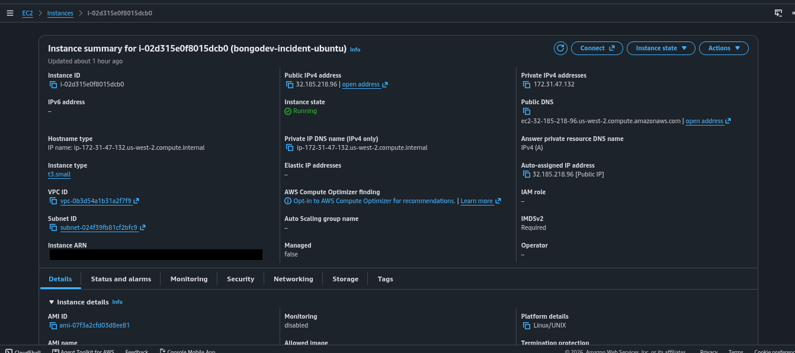

**02 — Security group inbound rules**: SSH (22) only from my IP (`/32`), HTTP (80) open to all. Ports **5000** and **5432** have no rule, so they are not reachable from the Internet. (The extra HTTPS 443 rule is unused; no TLS is configured.)
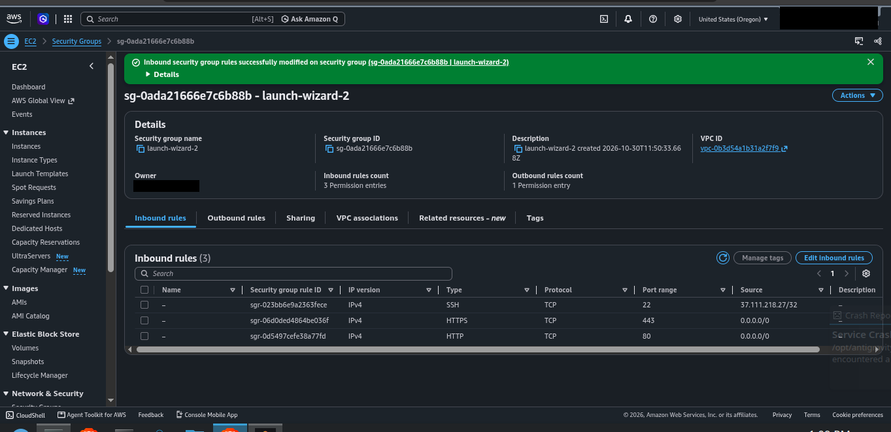

**03 — Connected to the instance over SSH** (`ubuntu@ip-172-31-47-132`, `us-west-2`)
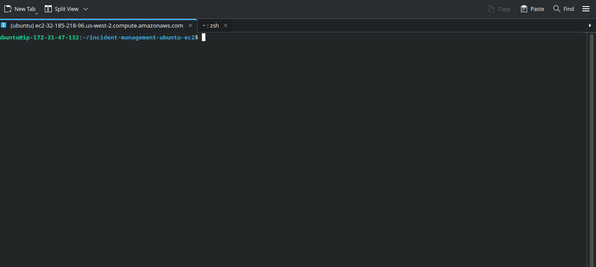

### Part B — Manual deployment

**04 — Node.js 24 installed** (`node -v` → `v24.22.2`)
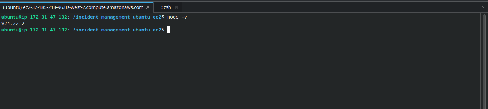

**05 — Node.js, PostgreSQL and Nginx installed natively** (`v24.22.2`, PostgreSQL 16.15, nginx/1.24.0)
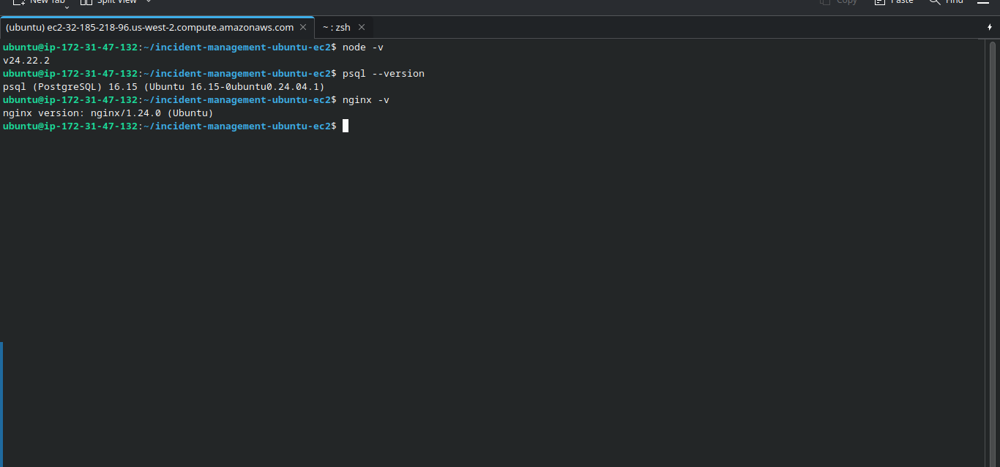

**06 — Backend managed by systemd** (`incident-backend.service` is `enabled` and `active (running)`, database connection established, listening on `127.0.0.1:5000`)
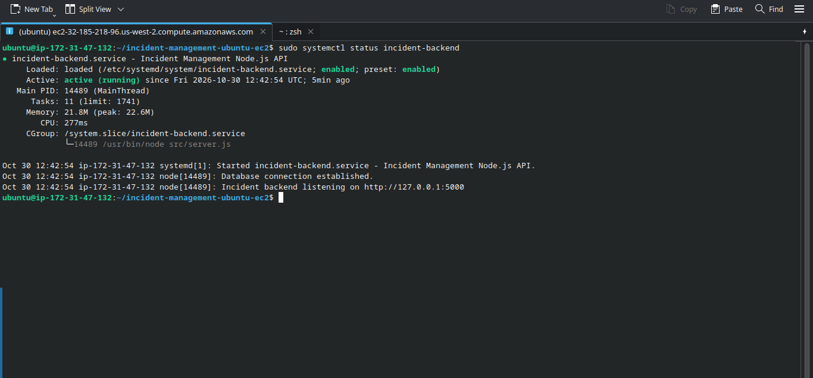

**07 — Health check** (`{"service":"incident-backend","status":"healthy","database":"connected"}`)
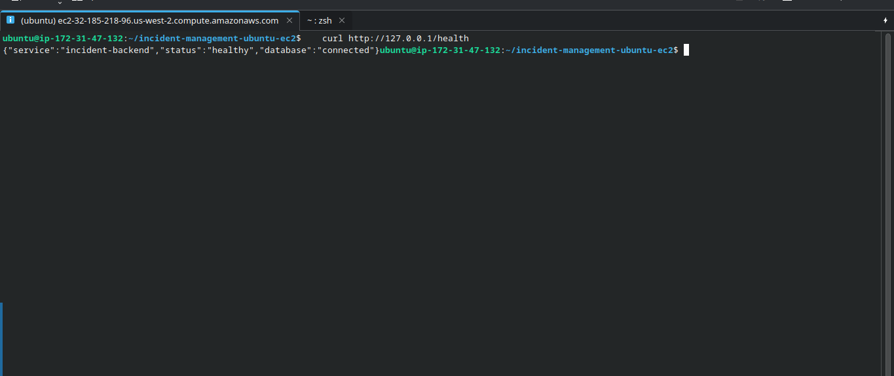

**08 — Database proof**: `SELECT id, title, severity, status FROM incidents` in `incidentdb` lists the persisted incidents, including one `resolved` and one `investigating`.
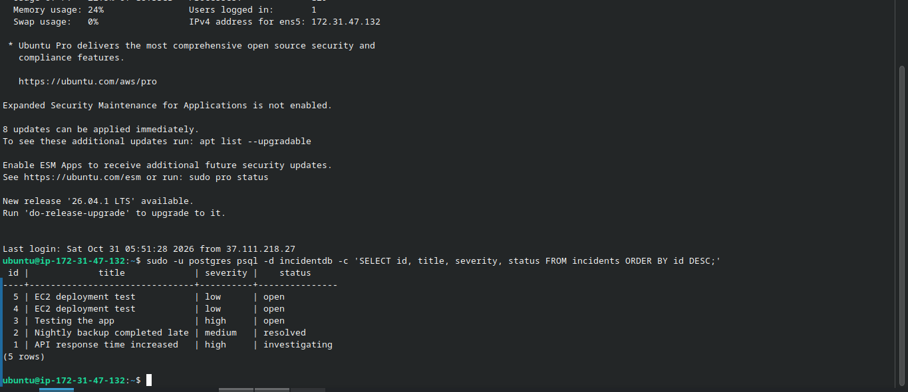

**09 — Public IP shows the app after the manual redeploy**: heading is *"Incident Command Center - Updated Manually"*, incidents are stored in PostgreSQL (one created with `curl`, one created in the UI), and one has status **Investigating**.
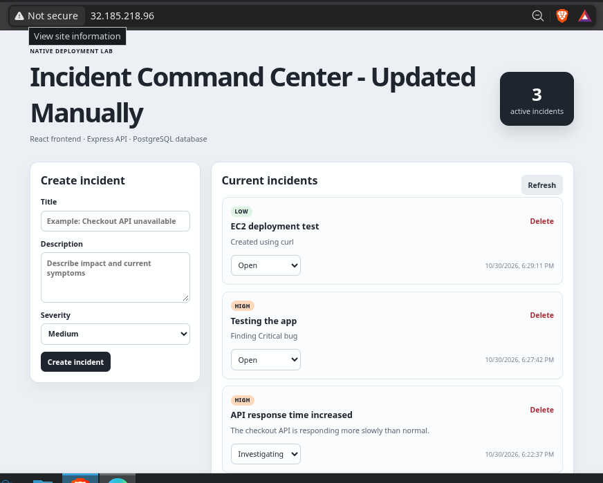

### Part C — GitHub Actions (self-hosted runner on the EC2 instance)

**10 — Registering the runner on EC2** (`./config.sh --url https://github.com/Levi9111/bongodev-incident-native ...`; token redacted)
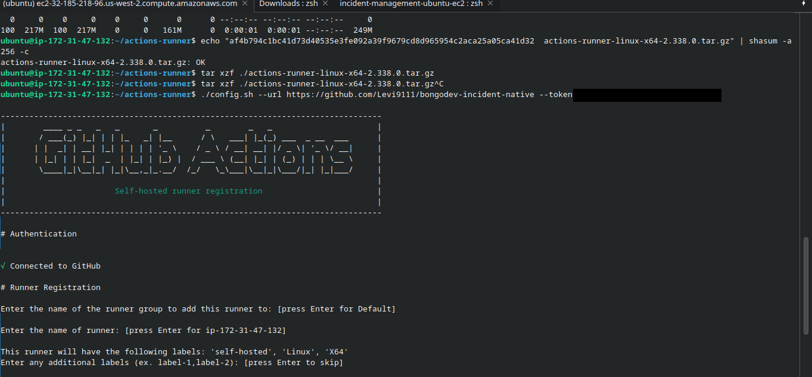

**11 — GitHub → Settings → Actions → Runners**: `ip-172-31-47-132` (`self-hosted`, `Linux`, `X64`) is registered and **Idle**
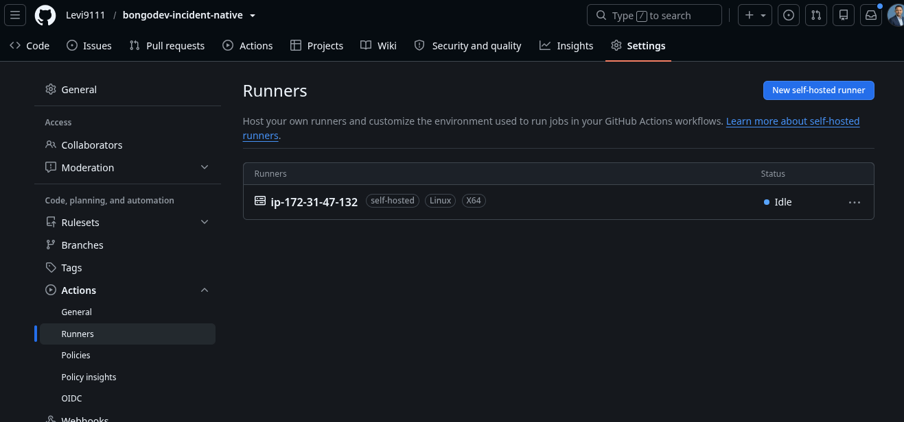

**12 — Runner on EC2 listening for jobs and finishing pushed jobs** (`Running job: Validate and build` → `Succeeded`)
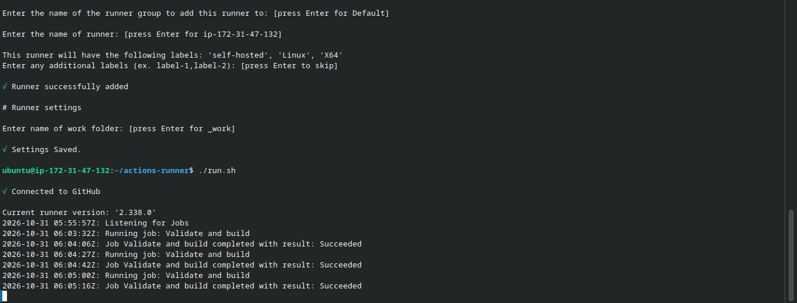

**13 — Live site updated automatically after `git push`**: heading *"Incident Command Center — Deployed Automatically!"*
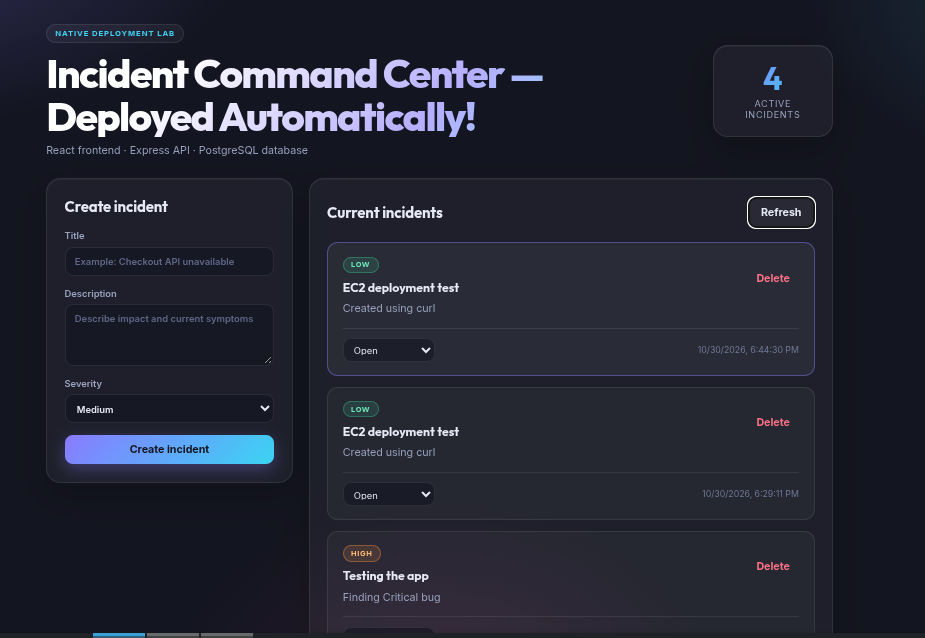

**14 — Successful GitHub Actions run (#6)**: both **Validate and build** and **Deploy on the Ubuntu EC2 self-hosted runner** passed (Success, 34 s). The only annotations are Node.js 20 deprecation warnings from GitHub's own actions.
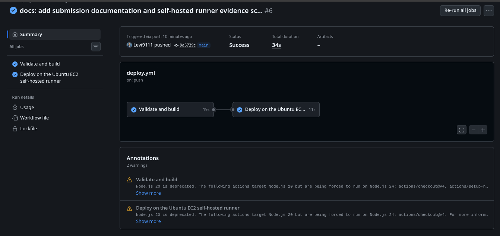

## 3. Architecture explanation

1. The browser sends an HTTP request on port 80 to the EC2 public IP, where **Nginx** receives it.
2. For `/` and static files, Nginx serves the compiled React app from `/var/www/incident-management`.
3. For `/api/*` and `/health`, Nginx acts as a reverse proxy to the **Express** API on `127.0.0.1:5000`.
4. Express reads and writes incidents in **PostgreSQL** on `127.0.0.1:5432`, so data survives page refreshes and restarts.
5. **systemd** (`incident-backend.service`) starts the Node process at boot and restarts it if it crashes.
6. Only port 80 is public (and SSH from my IP); ports 5000 and 5432 are bound to localhost and not exposed.
7. React must be built with `npm run build` and copied to Nginx to change the UI; creating an incident only needs the API and database.
8. GitHub Actions can automate install, build, copy to `/var/www`, systemd restart and Nginx reload after each `git push` — exactly what `scripts/deploy-ubuntu.sh` does manually.

## 4. GitHub Actions explanation

In this deployment, I connected GitHub to my AWS EC2 instance by installing a **self-hosted GitHub Actions runner** directly on the Ubuntu server. When I push code to the `main` branch, the runner (which is actively listening for jobs) picks up the workflow in `.github/workflows/deploy.yml`. Because the runner is already inside the EC2 instance, it does **not** need SSH keys or an inbound SSH connection from GitHub; it makes an outbound connection to GitHub and works on the code locally. It first validates and builds the app, then copies the new source into the app directory (leaving `backend/.env` untouched) and runs `scripts/deploy-ubuntu.sh`, which rebuilds the React frontend and restarts the systemd and Nginx services. This updates the live website automatically while keeping the security group locked down (no public SSH access required for GitHub).

## 5. Repository layout

| Path | Purpose |
|---|---|
| `SUBMISSION.md` | **This file** — evidence and explanations |
| `STUDENT_HOMEWORK.md` | Assignment checklist (ticked where evidence exists) |
| `step-by-step.md` | Original lab instructions |
| `submission/screenshots/` | All 14 screenshots, numbered in the order of the lab |
| `frontend/`, `backend/` | React + Vite client and Express API |
| `scripts/` | Install, DB setup, deploy and verify scripts |
| `deploy/` | Nginx site configuration |
| `.github/workflows/deploy.yml` | CI/CD: build job + deploy job, both on the self-hosted runner |
| `docs/GITHUB_ACTIONS.md` | Optional CI/CD walkthrough |
